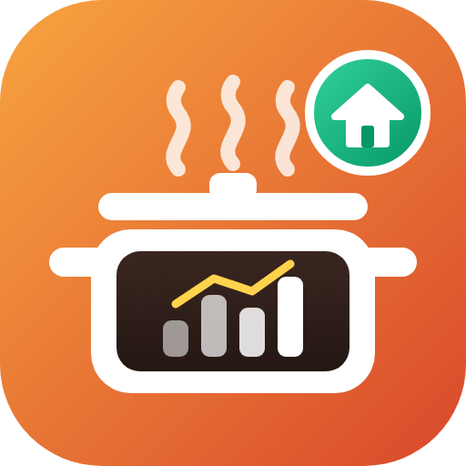

<p align="center"></p>

<h1 align="center">Home Recipes</h1>

<p align="center"><a href="https://github.com/Tntdruid/home-recipes/actions/workflows/ci.yaml"></a></p>

🇬🇧 [English](#english) · 🇩🇰 [Dansk](#dansk)

---

## English

A Home Assistant add-on with a recipe collection and statistics on what you cook. It is a sibling of [Jellyfin Music Stats](https://github.com/Tntdruid/jellyfin-music-stats). The add-on's own pages are in Danish.

- Recipes with ingredients, steps, tags, servings, time and a source link
- Search titles, ingredients and tags, and filter by tag
- Photos on recipes, and import from a Mealie backup (recipes, photos and "made this" history)
- Log a meal with one tap; the Home Assistant user is remembered
- Statistics: most cooked recipes, popular tags, recent meals and recipes you haven't made for a long time

See [home_recipes/DOCS.md](home_recipes/DOCS.md) for usage (in Danish).

### Installation in Home Assistant

1. Go to **Settings → Apps → App store → ⋮ → Repositories**.
2. Add `https://github.com/Tntdruid/home-recipes`.
3. Find **Home Recipes** in the store, install it and start it.
4. Open **Opskrifter** in the sidebar.

**Updates:** raise `version` in `home_recipes/config.yaml` and push. Home Assistant then shows the update in the store.

### Development

```bash
python -m venv .venv
.venv/Scripts/pip install -r requirements-dev.txt
.venv/Scripts/python dev/seed_demo.py
.venv/Scripts/python dev/run_demo.py
.venv/Scripts/python -m pytest tests
```

---

## Dansk

Et Home Assistant-add-on med en opskriftssamling og statistik over, hvad I laver mad af. Det er søster til [Jellyfin Music Stats](https://github.com/Tntdruid/jellyfin-music-stats).

- Opskrifter med ingredienser, fremgangsmåde, tags, antal personer, tid og link til kilden
- Søg i titler, ingredienser og tags, og filtrér på tags
- Billeder på opskrifterne og import fra en Mealie-backup (opskrifter, billeder og "lavede denne"-historik)
- Registrér et måltid med ét tryk; Home Assistant-brugeren bliver husket
- Statistik: mest lavede opskrifter, populære tags, seneste måltider og opskrifter, I ikke har lavet længe

Se [home_recipes/DOCS.md](home_recipes/DOCS.md) for brug.

### Installation i Home Assistant

1. Gå til **Indstillinger → Apps → App-butik → ⋮ → Repositories**.
2. Tilføj `https://github.com/Tntdruid/home-recipes`.
3. Find **Home Recipes** i butikken, installér og start den.
4. Åbn **Opskrifter** i sidebaren.

**Opdateringer:** hæv `version` i `home_recipes/config.yaml` og push. Så viser Home Assistant opdateringen i butikken.
